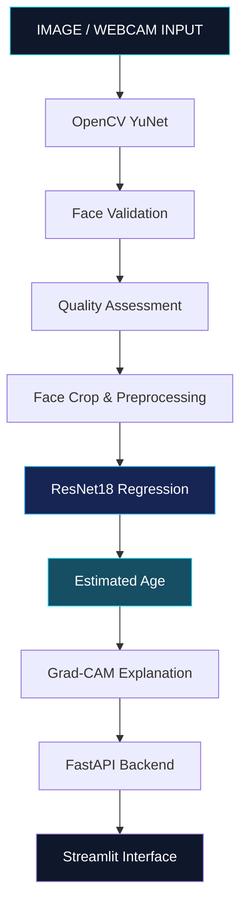

 <div align="center">


<br/>


<br/>

**A deep learning-powered age estimation system combining face detection, neural networks, real-time inference and explainable AI.**

<br/>

[](https://www.python.org/)
[](https://pytorch.org/)
[](https://opencv.org/)
[](https://fastapi.tiangolo.com/)
[](https://streamlit.io/)
[](#)

</div>

---

## ◈ 01 — Project Vision

**VerifiAge** is an AI-powered facial age estimation system designed to estimate a person's approximate age from facial images.

It combines computer vision-based face detection with a fine-tuned ResNet18 regression model to produce continuous age predictions.

Beyond prediction, VerifiAge incorporates image-quality validation, webcam inference and Grad-CAM visualizations to provide a more interpretable and practical AI experience.

> Not just face detection. Not just prediction. An integrated facial age analysis pipeline.

## ◈ 02 — The Intelligence Behind VerifiAge

<div align="center">

|  |  |
|---|---|
| OpenCV YuNet detects facial regions. | Face count, confidence and image quality checks. |

|  |  |
|---|---|
| Fine-tuned ResNet18 feature extraction. | Continuous age regression prediction. |

|  |  |
|---|---|
| Grad-CAM visual explanations. | Webcam inference with prediction smoothing. |

</div>

## ◈ 03 — Model Performance

<div align="center">


<br/>

| Metric | Evaluated Result |
|:---:|:---:|
| Mean Absolute Error | **5.9648 years** |
| Root Mean Squared Error | **8.1248 years** |
| R² Score | **0.6940** |
| Mean Signed Error | **-0.6403 years** |

</div>

The model uses an ImageNet-pretrained ResNet18 backbone, fine-tuned for continuous age regression.

*Results represent the reported experimental evaluation and do not guarantee individual prediction accuracy.*

## ◈ 04 — System Architecture

<div align="center">


</div>



## ◈ 05 — Technology Arsenal

<div align="center">

| Layer | Technology |
|---|---|
| Language | Python |
| Deep Learning | PyTorch |
| Neural Architecture | ResNet18 |
| Face Detection | OpenCV YuNet |
| Image Processing | OpenCV, PIL |
| Explainability | Grad-CAM |
| Backend | FastAPI |
| Frontend | Streamlit |
| Evaluation | MAE, RMSE, R² |

</div>

## ◈ 06 — Experience the Pipeline

<div align="center">

**01 — DETECT**


Identify and validate facial regions from an input image or webcam stream.

<br/>

**02 — ANALYZE**


Process the detected face through the trained neural network.

<br/>

**03 — ESTIMATE**


Generate a continuous age estimate and visualization.

</div>

## ◈ 07 — Explainable AI

VerifiAge integrates **Grad-CAM (Gradient-weighted Class Activation Mapping)** to visualize regions contributing to the prediction.

This helps explore how the model responds to facial image features rather than presenting only a numerical output.

<div align="center">


<sub>Replace this placeholder with your actual Grad-CAM output.</sub>

</div>

## ◈ 08 — Run VerifiAge Locally

### Clone the repository

```bash
git clone https://github.com/<USERNAME>/<REPOSITORY>.git
cd <REPOSITORY>
```

### Create an environment

```bash
python -m venv venv
```

**Windows**

```bash
venv\Scripts\activate
```

**Linux / macOS**

```bash
source venv/bin/activate
```

### Install dependencies

```bash
pip install -r requirements.txt
```

### Start the API

Use the module and application object defined in your FastAPI source:

```bash
uvicorn <module>:<app_object> --reload
```

### Start the interface

```bash
streamlit run <your_streamlit_entrypoint>.py
```

Ensure the trained model checkpoint and YuNet model files are available at the paths configured in the project.

## ◈ 09 — Project Gallery

<div align="center">

| Dashboard | Face Detection |
|---|---|
|  |  |

| Age Estimation | Grad-CAM |
|---|---|
|  |  |

</div>

*Replace the example image paths with screenshots from your actual application.*

## ◈ 10 — Future Roadmap

- [ ] Explore stronger vision architectures.
- [ ] Improve age prediction across diverse age groups.
- [ ] Expand robustness and bias evaluation.
- [ ] Optimize inference speed.
- [ ] Improve prediction calibration and uncertainty estimation.
- [ ] Enhance real-time visualization and explainability.

## ◈ 11 — Important Disclaimer

VerifiAge is an experimental AI research and development project.

Its predictions are approximate estimates, not verified ages or identity information. Results may be influenced by lighting, image quality, facial appearance and dataset limitations.

It should not be used as the sole basis for legal age verification, identity verification or other high-stakes decisions. Obtain appropriate consent before processing facial images.

---

<div align="center">


<br/>

**Built with Computer Vision · Deep Learning · Explainable AI**


</div>
