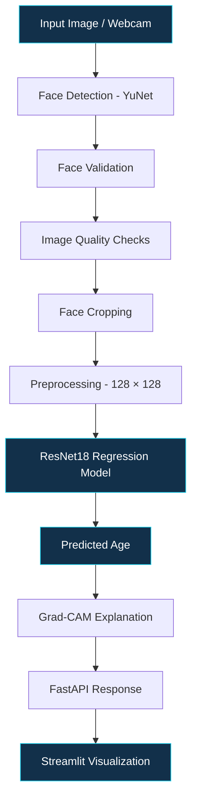

 
<div align="center">

# VerifiAge

### AI-Powered Face-Based Age Estimation


<br/>


<br/>

[](https://python.org/)
[](https://pytorch.org/)
[](https://opencv.org/)
[](https://fastapi.tiangolo.com/)
[](https://streamlit.io/)

<br/>

**An intelligent computer vision system that detects human faces and estimates age using deep learning, with real-time inference and visual explanations.**

</div>

---

## Overview

**VerifiAge** is an AI-powered face-based age estimation system that combines computer vision and deep learning to predict a person's approximate age from facial images.

The system uses OpenCV's YuNet face detector for face validation and preprocessing, followed by a fine-tuned ResNet18 regression model for age prediction.

Designed with both image-upload and webcam-based inference, VerifiAge provides an integrated experience through a FastAPI backend and Streamlit interface.

The objective is to build a practical, modular and explainable age-estimation pipeline rather than simply producing a numerical prediction.

## Key Features

| Feature | Description |
|---|---|
| Face Detection | Detects faces using OpenCV YuNet |
| Face Validation | Checks face count, detection confidence and image quality |
| Age Estimation | Predicts approximate age using a ResNet18 regression model |
| Image Inference | Supports uploaded facial images |
| Live Inference | Supports webcam-based age estimation |
| Prediction Smoothing | Uses recent predictions to stabilize live estimates |
| Explainable AI | Grad-CAM visualizations to interpret model attention |
| REST API | FastAPI-based prediction backend |
| Interactive Interface | Streamlit application for user interaction |

## How VerifiAge Works

<div align="center">

### The Age Estimation Pipeline

</div>



### 1. Face Detection and Validation

- OpenCV YuNet is used for face detection.
- Validates the number of detected faces.
- Applies detection-confidence and minimum-face-size checks.
- Performs image quality checks, including brightness and blur validation.
- Extracts the detected facial region for inference.

### 2. Image Preprocessing

The detected face is processed before entering the deep learning model.

- Face cropping and alignment preparation.
- Resizing to 128 × 128.
- Image normalization using ImageNet statistics.
- Training-time augmentations to improve model generalization.

### 3. Deep Learning-Based Age Prediction

The core prediction engine uses **ResNet18**, initialized with ImageNet-pretrained weights and fine-tuned for age regression.

Instead of classifying an image into an age category, the model predicts a continuous numerical age value.

### 4. Explainable AI

Grad-CAM is integrated to visualize the regions of the facial image that contribute to the model's prediction.

This provides an additional interpretability layer to help understand model behavior.

### 5. Live Webcam Estimation

The webcam pipeline periodically performs face detection and inference. Recent predictions are smoothed over a rolling window of five predictions to reduce fluctuations in the displayed estimate.

---

## Model Performance

The final evaluated model achieved the following results:

<div align="center">

| Evaluation Metric | Result |
|:---:|:---:|
| **Mean Absolute Error (MAE)** | **5.9648 years** |
| **Root Mean Squared Error (RMSE)** | **8.1248 years** |
| **R² Score** | **0.6940** |
| **Mean Signed Error** | **-0.6403 years** |

</div>

### Understanding the Results

- **MAE:** The average absolute difference between predicted and actual ages was approximately 5.96 years.
- **RMSE:** Penalizes larger prediction errors more heavily.
- **R²:** Indicates how much variation in the target age values is explained by the model.
- **Mean Signed Error:** Indicates a small average underestimation in the evaluated predictions.

These are experimental evaluation results and should not be interpreted as a guarantee of accuracy for every individual.

---

## Technology Stack

<div align="center">

| Category | Technologies |
|---|---|
| Programming Language | Python |
| Deep Learning Framework | PyTorch |
| Model Architecture | ResNet18 |
| Face Detection | OpenCV YuNet |
| Image Processing | OpenCV, PIL |
| Explainable AI | Grad-CAM |
| Backend | FastAPI |
| Frontend | Streamlit |
| Model Evaluation | MAE, RMSE, R² |
| Development | Jupyter Notebook, Python |

</div>

---

## Installation and Setup

### 1. Clone the Repository

```bash
git clone https://github.com/<your-username>/<your-repository>.git
cd <your-repository>
```

### 2. Create a Virtual Environment

```bash
python -m venv venv
```

Activate it:

**Windows**

```bash
venv\Scripts\activate
```

**Linux / macOS**

```bash
source venv/bin/activate
```

### 3. Install Dependencies

```bash
pip install -r requirements.txt
```

### 4. Configure Model Weights

Ensure the trained ResNet18 checkpoint is available at the model path configured in the project.

### 5. Start the Backend

VerifiAge uses FastAPI and exposes an age-analysis endpoint:

```text
POST /analyze
```

Start the backend using the actual FastAPI application module in your repository. For example, if the application is defined in `main.py`:

```bash
uvicorn main:app --reload
```

### 6. Launch the Streamlit Interface

Run the Streamlit entry-point file in your repository:

```bash
streamlit run <your-streamlit-entrypoint>.py
```

Open the local Streamlit URL displayed in your terminal.

---

## Application Modules

| Module | Responsibility |
|---|---|
| Face Detection | Identifies and validates facial regions |
| Preprocessing | Prepares input images for model inference |
| Age Prediction | Performs ResNet18-based regression |
| Explainability | Generates Grad-CAM visualizations |
| API Layer | Handles prediction requests |
| User Interface | Provides image upload and webcam interaction |

---

## Screenshots and Demonstration

<div align="center">

### Application Interface

</div>

Add your actual project screenshots in the `assets` directory and display them here.

```markdown


```

---

## Future Improvements

- Explore stronger vision backbones and vision foundation models.
- Improve prediction accuracy across different age groups.
- Expand demographic and image-quality robustness evaluation.
- Optimize inference latency for real-time applications.
- Improve model calibration and uncertainty estimation.
- Extend explainability and model evaluation capabilities.

---

## Important Disclaimer

VerifiAge is an experimental AI-based age-estimation project.

Its output is an approximate prediction, not a verified identity or legally valid age confirmation. Predictions may vary due to lighting, facial appearance, image quality, dataset bias and other factors.

It should not be used as the sole basis for identity verification, legal age verification, access control or other high-stakes decisions.

Facial images are sensitive personal data. Use only images for which appropriate consent and authorization have been obtained.

---

## Project Information

<div align="center">

**VERIFIAGE — AI-POWERED AGE ESTIMATION**

Built using Computer Vision, Deep Learning and Explainable AI.

<br/>

*Detect. Analyze. Estimate.*

</div>
